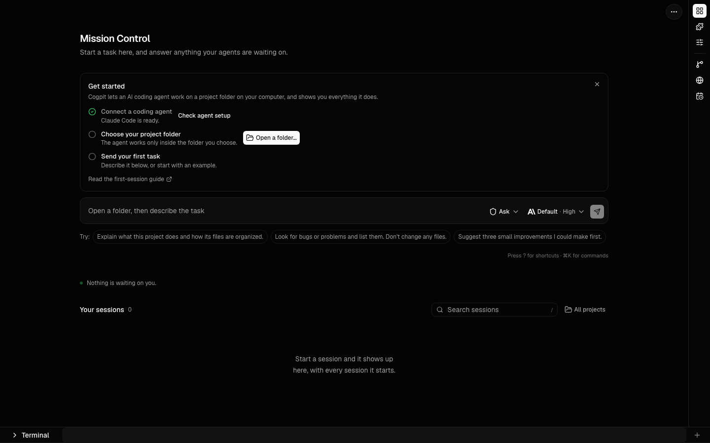
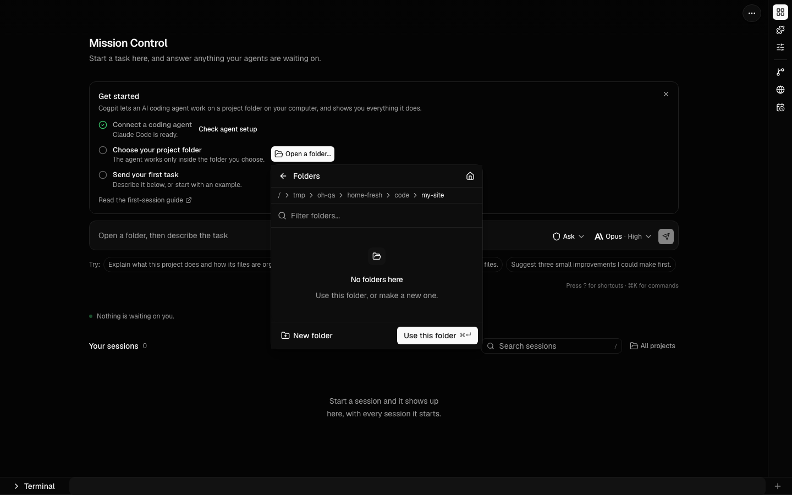
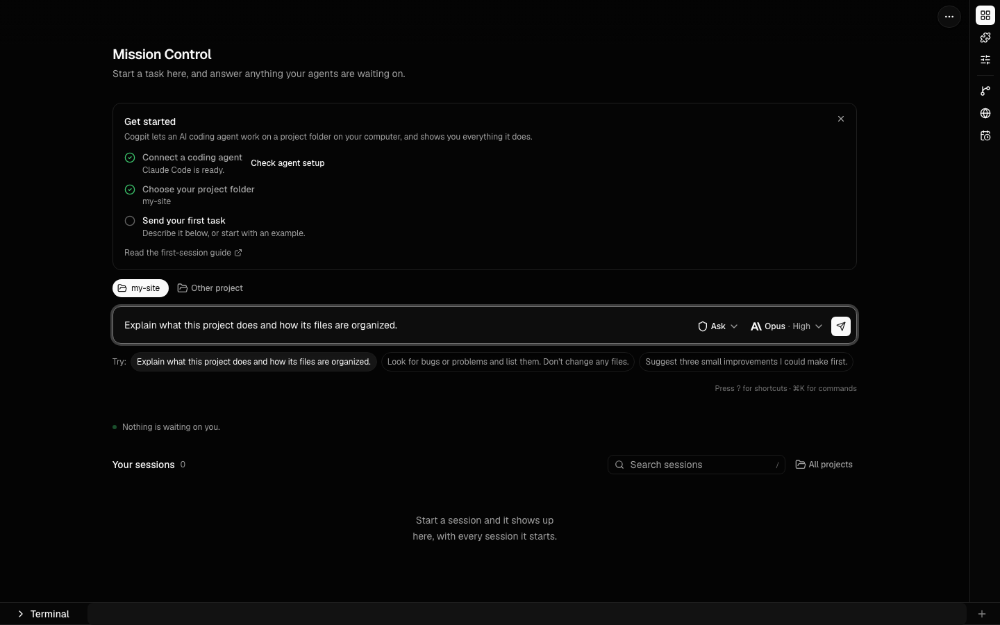

# Your first session

This guide takes you from opening Cogpit to a first finished task. You need no terminal experience.

## 1. Open Cogpit

Open the desktop app, or run `npx cogpit@latest` and use the page it opens. You start on **Mission Control**, where all work begins. On a new install it shows a **Get started** checklist that ticks itself as you go.

## 2. Check your agent

Cogpit drives a coding agent: Claude Code, OpenAI Codex or GitHub Copilot CLI. The first step says whether one is ready. If it is not, choose **Check agent setup**. It shows which agents are installed, how to install one, and a **Sign in** button for an agent that needs it.

## 3. Open your project folder

Choose **Open a folder…** and go to the folder your project lives in. You can also type a path, such as `~/code/my-site`. The agent works only inside the folder you choose, so pick the project's own folder: Cogpit warns you if you are about to choose your whole home folder. Then choose **Use this folder**.

## 4. Send your first task

Describe what you want in the box, or click one of the examples under it. A task that only reads, such as "Explain what this project does", is a good first one. The chips in the box show which agent and model will run, and its **access**. A new install starts on **Ask** (Codex calls it **Workspace**), so the agent asks before it runs a command or changes a file. Press Enter to send.

**Full access** lets the agent act without asking. Use it only in folders you trust; Cogpit explains it the first time you choose it.

## 5. Approve a request

When the agent wants to run a command or change a file, a request appears above the message box. It says exactly what the agent wants to do. Allow it, or deny it and tell the agent what to do instead. Requests from every session also wait for you on Mission Control under **Needs you**.

## 6. See what changed

The conversation shows each command and edit as it happens. Open one to see its output or the exact change. The file changes panel lists every file the session changed, and the undo controls step back if a change is not what you wanted.

## Getting help

Press `?` for keyboard shortcuts and `Cmd+K` (`Ctrl+K` on Windows and Linux) for every command. **Help & docs** in the ⋯ menu links here and to the issue tracker. [Using Cogpit](usage.md) covers everything else.
